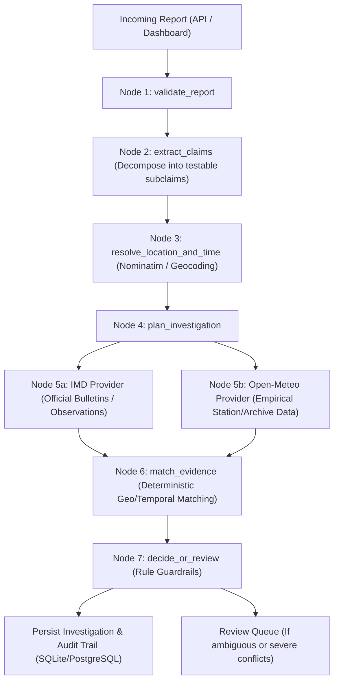

# Architecture of WeatherSignal

WeatherSignal is an agentic weather verification system built to audit and corroborate or contradict weather claims using verifiable real-world evidence.

## Core Modules

1. **API Layer (`backend/app/main.py`)**:
   - Versioned REST endpoints under `/api/v1/`
   - Health and readiness endpoints (`/health`, `/ready`)
   - Human review actions with mandatory operational rationale.

2. **Data Model (`backend/app/models/models.py` & `schemas.py`)**:
   - Reports, decomposed Claims, Evidence Items, Assessments, and Final Decisions.

3. **Providers (`backend/app/providers/`)**:
   - `IMDProvider`: Official India Meteorological Department API client matching official contracts (`/districtwarning`, `/districtrainfall`, etc.). Requires `x-api-key`. Accurately reports `NOT_CONFIGURED` when key is absent.
   - `OpenMeteoProvider`: Empirical weather observation provider offering public, keyless observation data for any latitude/longitude in India and globally.

4. **Deterministic Engine (`backend/app/services/`)**:
   - Haversine great-circle distance evaluation and temporal decay windows.
   - Verification rules:
     - Forecast $\neq$ Observation.
     - Warning $\neq$ Ground Impact.
     - Supported rainfall + unverified flood = `PARTIALLY_CORROBORATED` (never false full corroboration).
